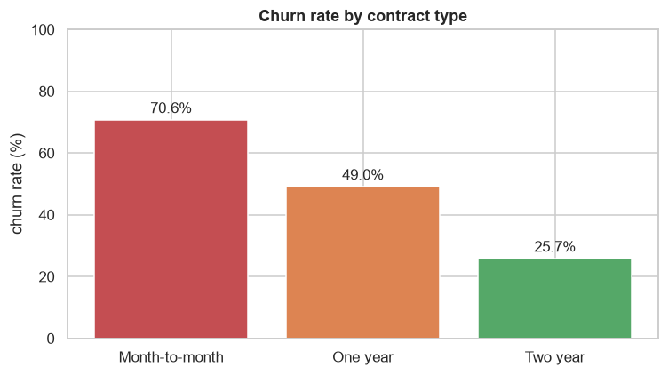
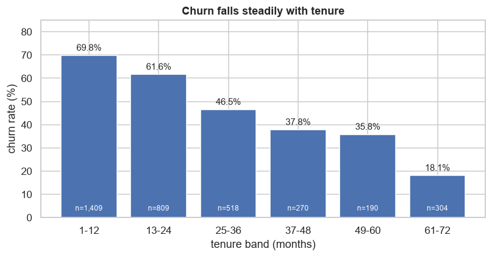
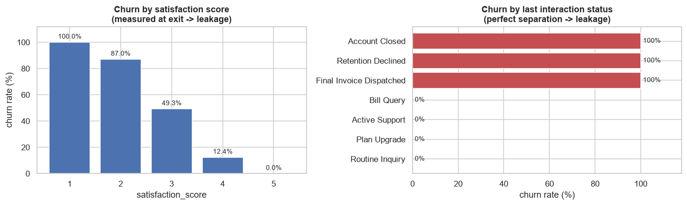

# Day 6 — Telco churn EDA report

A complete exploratory data analysis of a synthetic telecom churn dataset, written as a
**portfolio-ready report**, a **step-by-step teaching guide**, and a **45-minute blank-file test**.

> **One-sentence finding.** In this sample churn is the *majority* outcome (55.6%); contract type,
> tenure and support calls are the strongest legitimate drivers, while four columns are recorded
> *after* the customer left and must be removed before any modelling.

---

## What's inside

| File | What it is |
|---|---|
| **[`guide.ipynb`](guide.ipynb)** | Guided walkthrough of the 7-step EDA workflow — read this first if you are learning |
| **[`eda_report.ipynb`](eda_report.ipynb)** | The polished report: Context → Data → Cleaning → Insights → Next steps |
| **[`blank_file_test.ipynb`](blank_file_test.ipynb)** | 3 timed pandas tasks (15 min each), empty cells, self-check |
| **[`blank_file_test_solutions.ipynb`](blank_file_test_solutions.ipynb)** | Solutions with real outputs (open only after the test) |
| `generate_data.py` | Deterministic dataset generator (`random_state=42`) |
| `figures/` | Charts saved by the report |
| `data/` | Generated CSV — **gitignored**, rebuild it with one command |

## The five insights

| # | Insight (plain language) | Evidence |
|---|---|---|
| 1 | **Churn is the majority here, so accuracy lies.** A model that always says "churn" is already 55.6% accurate. | 1,947 / 3,500 churned; real Telco is ≈26.5% |
| 2 | **Contract length is the biggest lever the company controls.** Month-to-month customers leave three times as often as two-year customers. | 70.6% vs 49.0% vs 25.7%; month-to-month + fiber = **82.4%** (860 customers) |
| 3 | **The first year is the danger zone.** Churn falls steadily the longer someone stays. | 69.8% in months 1–12 → 18.1% after 5 years |
| 4 | **Support calls are an early-warning siren.** After three calls, churn is more likely than not. | 11.1% (0 calls) → 39.6% (1–2) → 78.8% (3–4) → 96.6% (5–6) → 100% (7+) |
| 5 | **Four columns leak the answer.** They are recorded at/after exit and separate churn perfectly; a 99.9%-accurate model that uses them is worthless. | `cancellation_request`, `last_interaction_status`, `churn_risk_post_exit_code`, `satisfaction_score` |





## Dataset

* **3,500 customers × 23 columns**, target `churn` (1 = left).
* Synthetic, generated with a fixed seed, so results are reproducible. It mimics the classic Kaggle
  *Telco Customer Churn* set but **plants realistic problems**:
  * missing values in three ordinary columns + one informative column (44% missing),
  * four post-outcome **leakage** columns,
  * one **derived** column (`total_charges ≈ monthly_charges × tenure`).
* No real customer data and no personal information.

`data/` is **not committed** (the repository stays small). Rebuild the exact CSV with:

```bash
python generate_data.py     # writes data/telecom_churn.csv, seed 42
```

## Run the notebooks

```bash
# from this folder (W2/d6)
python -m pip install -r requirements.txt
python generate_data.py
jupyter notebook            # open guide.ipynb or eda_report.ipynb, Run All
```

Tested with Python 3.12 / pandas 3.0, matplotlib 3.11, seaborn 0.13.

## The blank-file test (45 minutes)

`blank_file_test.ipynb` contains three tasks with **empty cells**:

| Task | Time | Skill |
|---|---|---|
| 1 — data health check | 15 min | shape, missing table, duplicates, cost of `dropna()` |
| 2 — segment churn | 15 min | `groupby`, `pd.cut`, rates with sample sizes, one chart |
| 3 — leakage audit | 15 min | cross-tabs vs target, removing leakage, written insight |

Rules: close the guide, no AI assistant, 15 minutes per task, grade yourself with the hidden
self-checks, then open `blank_file_test_solutions.ipynb`. **2/3 correct = ready.**

## Project structure

```
W2/d6/
├── guide.ipynb                       # teaching walkthrough (7-step workflow + exercises)
├── eda_report.ipynb                  # Context → Data → Cleaning → Insights → Next steps
├── blank_file_test.ipynb             # 3 timed tasks, empty cells
├── blank_file_test_solutions.ipynb   # executed solutions
├── generate_data.py                  # deterministic dataset generator (seed 42)
├── requirements.txt
├── README.md
├── figures/                          # charts saved by the report
└── data/                             # generated CSV (gitignored)
```

## What this day taught me

* **EDA is a set of decisions, not a set of plots.** Every cleaning step in the report has a reason
  and a measured consequence (for example: `dropna()` would delete 46.7% of the rows).
* **Leakage checks are mandatory.** Four columns predicted churn almost perfectly — because they
  were recorded after the customer had already left.
* **A rate without a sample size is not evidence.** The report always shows `n` next to a
  percentage, and the test requires a minimum segment size of 100 customers.
* **An insight needs an action.** Each of the five findings ends with what the business should do
  next, not just what the data looks like.

## Next steps

1. Model the cleaned data with a majority-class baseline and logistic regression, then gradient
   boosting; use PR-AUC and a cost-weighted threshold (missed churner ≈ $500, false alarm ≈ $100).
2. Calibrate probabilities before choosing a threshold.
3. Collect better data: satisfaction measured *during* the customer's life, cancellation reasons,
   interaction dates (the file has no dates, so a time-based split is impossible — say so honestly).
4. Run controlled experiments: contract-upgrade offer for month-to-month + fiber; onboarding for
   months 1–3; callback after the second support call.
