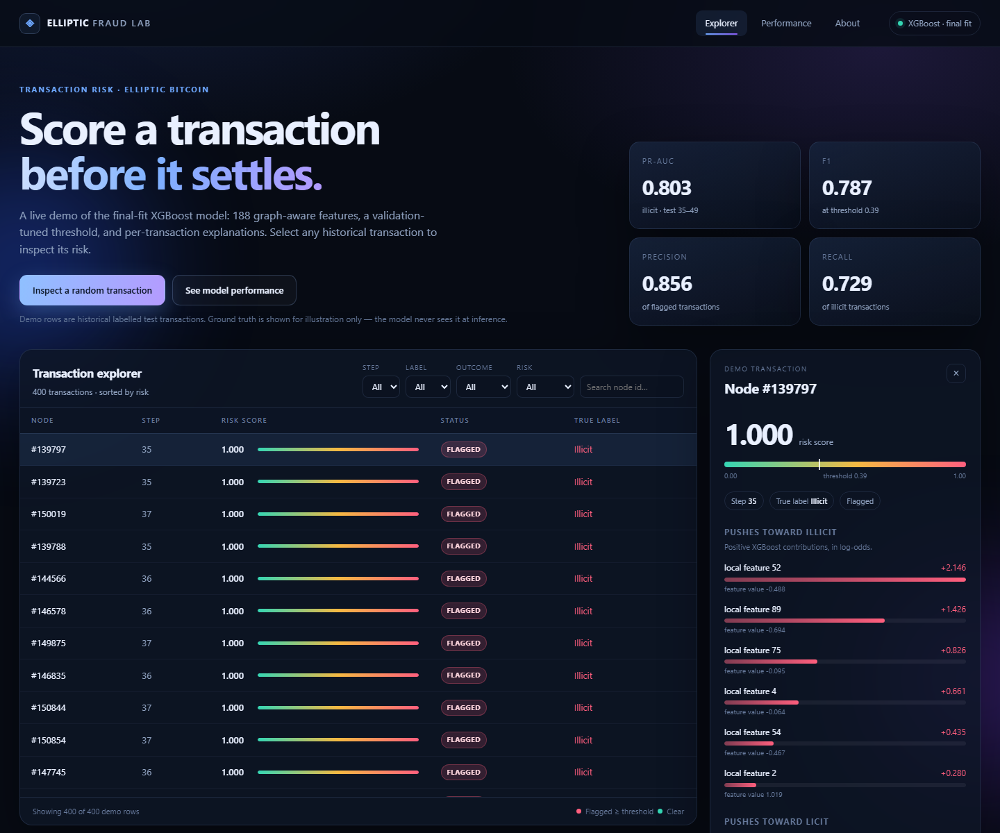

# Elliptic Bitcoin Fraud Detection

Illicit-transaction detection on the Elliptic Bitcoin graph, comparing XGBoost with
GraphSAGE / GCN / GAT under a strictly temporal split. Includes a live, zero-dependency
portfolio demo.

**Key finding:** graph message passing did not beat a strong tabular model. Graph-derived
features did. XGBoost on local features + degree + neighbour-contrast reaches **0.796 test
PR-AUC / 0.754 F1** train-only, and **0.803 / 0.787** after the final fit on steps 1–34.
The best GNN (SAGE, local features) reaches **0.712 / 0.666**.



## Live demo

A custom frontend with live XGBoost scoring and per-transaction feature contributions:

```powershell
.venv\Scripts\python.exe app\server.py
# open http://127.0.0.1:8000
```

The app serves the 5-seed final-fit model, 400 labelled historical test transactions, and
the saved performance figures. See [app/README.md](app/README.md) for deployment.

## Results

| Model | Training | Test PR-AUC | Test F1 |
|---|---|---:|---:|
| **XGBoost final fit** | steps 1–34, 332 trees, 5 seeds | **0.803** | **0.787** |
| XGBoost train-only | steps 1–29, early stopping | 0.796 | 0.754 |
| SAGE local | steps 1–29, 3 seeds | 0.712 | 0.666 |

The final fit uses validation labels, so 0.803 is deployment-style; **0.796** is the
VAL-selected number. Full tables, ablations, bootstrap intervals and caveats are in
[results/RESULTS.md](results/RESULTS.md).

## How it works

- **Temporal split:** train steps 1–29, validation 30–34, test 35–49. Unknown-label nodes
  stay in the graph but never enter the loss or metrics.
- **Features:** 93 local transaction features, log in/out degree, and 93
  neighbour-contrast features (`x_local − mean(neighbour x_local)`). The last 72
  dataset-provided aggregated features are dropped for the best model.
- **Threshold:** chosen on validation only, then applied unchanged to test.
- **Evaluation:** illicit-class PR-AUC, F1, precision and recall; per-step F1 for the
  post-step-43 regime change.
- **Models tried:** XGBoost, GCN, GraphSAGE, GAT, class weights, focal loss, feature
  ablations, residual/concat heads, rolling-origin evaluation.

## Reproduce

```powershell
.venv\Scripts\python.exe scripts\03_baseline.py
.venv\Scripts\python.exe scripts\04_gnn.py
.venv\Scripts\python.exe scripts\05_gnn_ablation.py
.venv\Scripts\python.exe scripts\06_imbalance.py
.venv\Scripts\python.exe scripts\10_boost.py
.venv\Scripts\python.exe scripts\14_final_fit.py
.venv\Scripts\python.exe scripts\16_rolling.py
```

Rebuild the demo assets with `scripts\17_build_app.py`. Figures come from
`scripts\11_final_plots.py`.

## Repository map

```text
src/                 data loading, metrics, models, GNN training
scripts/             experiments, report, figures, demo build
results/             RESULTS.md (single source of truth) + raw JSON/PNG
app/                 zero-dependency demo: stdlib server + vanilla frontend
app/model/           5 exported XGBoost boosters (.ubj)
app/data/            400 demo rows + metadata
Procfile             deployment entry point
```

## Honest limitations

- **Validation is saturated and anti-correlated with test.** It does not rank configs;
  several VAL-selected choices lost on test. The report states this explicitly.
- **Prior shift.** Validation is 16.8% illicit, test 6.5%. Steps 43–49 have only 2–56
  illicit nodes each, so per-step F1 there is noisy and partly threshold-driven.
- **Final-fit caveat.** Steps 1–34 are used for training in the deployed model, so its
  validation PR-AUC is not a held-out number. Use the train-only 0.796 for comparisons.
- **Graph context required.** Degree and contrast features need the Elliptic graph; the
  demo is not a plug-in scorer for arbitrary raw transactions.
- **Negative result.** No GNN variant beat local-feature SAGE; class weights hurt GNNs,
  focal loss did not help, and graph message passing added little beyond the provided
  aggregates. This is documented rather than hidden.

## Stack

Python 3.12 · PyTorch · PyTorch Geometric · XGBoost · scikit-learn · pandas · matplotlib.
The demo server needs only NumPy and XGBoost.

Dataset: Elliptic Bitcoin dataset (Weber et al., 2019). Portfolio project; not a
production fraud system.
