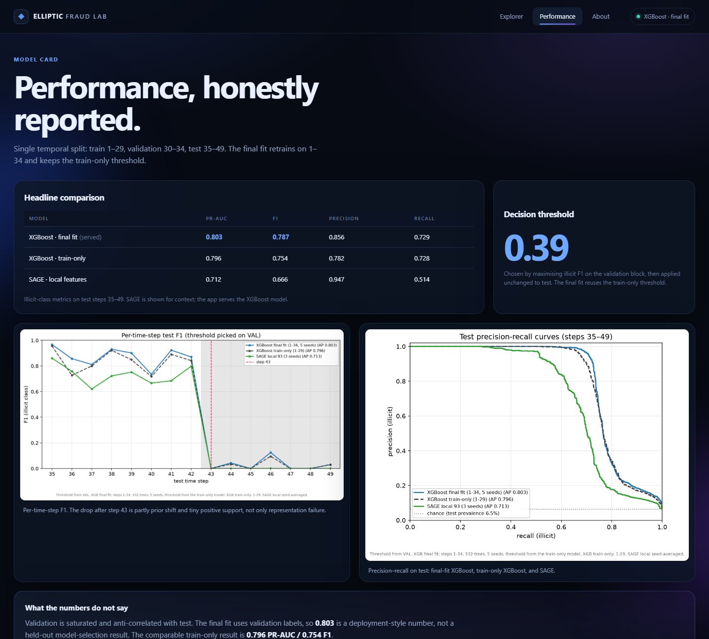

# Elliptic Fraud Lab — portfolio demo

A zero-dependency web demo for the Elliptic Bitcoin fraud model: a Python stdlib API
serving the 5-seed XGBoost final fit, plus a vanilla HTML/CSS/JS frontend with live
scoring and per-transaction explanations.

## What it shows

- **Explorer**: 400 labelled historical test transactions (steps 35–42), filterable by
  step, label and risk. Click a row for the live probability, the threshold, and the
  XGBoost feature contributions that moved the score.
- **Performance**: the honest model card — final-fit XGBoost (PR-AUC 0.803, F1 0.787),
  train-only XGBoost (0.796 / 0.754), and SAGE-local (0.712 / 0.666) — plus the saved
  per-step F1 and PR-curve figures.
- **About**: dataset facts, feature construction, and limitations (validation saturation,
  prior shift, final fit using validation labels).




## Run locally

The model and demo rows are already built into `app/model/` and `app/data/`.

```powershell
.venv\Scripts\python.exe app\server.py
# open http://127.0.0.1:8000
```

To rebuild the artifacts from the dataset (requires the full training environment and
`data/elliptic/`):

```powershell
.venv\Scripts\python.exe scripts\17_build_app.py
```

## Deploy

The server only needs `numpy` and `xgboost`; the training stack (torch, PyG) is not
required at serving time.

```text
pip install -r app/requirements.txt
python app/server.py --host 0.0.0.0 --port $PORT
```

A `Procfile` is included for Render/Railway-style hosts:

```text
web: python app/server.py --host 0.0.0.0 --port $PORT
```

## API

| Method | Path | Returns |
|---|---|---|
| GET | `/api/meta` | metrics, threshold, feature names, demo metadata |
| GET | `/api/transactions` | demo rows with probabilities |
| GET | `/api/transaction/<id>` | one row, top positive/negative contributions |
| POST | `/api/predict` | score a JSON body `{"features": [...188 floats]}` |
| GET | `/health` | `{"ok": true, "rows": 400}` |

Example:

```bash
curl -X POST http://127.0.0.1:8000/api/predict \
  -H "Content-Type: application/json" \
  -d '{"features": [ ...188 floats... ]}'
```

## Layout

```text
app/
  server.py          stdlib HTTP server + JSON API
  static/
    index.html       Explorer / Performance / About
    style.css        dark portfolio theme, responsive
    app.js           vanilla JS: filters, detail drawer, charts
    img/             per_step_f1.png, pr_curves.png
  data/
    demo.npz         400 rows: X (188), y, step, node, prob
    meta.json        metrics, threshold, feature names
  model/
    xgb_0.ubj ... xgb_4.ubj
  requirements.txt
Procfile
scripts/17_build_app.py
```

## Honest caveats

- Demo rows are historical labelled test transactions; ground truth is shown for
  illustration only.
- The final fit trains on steps 1–34 (including validation labels), so 0.803 is a
  deployment-style number. The train-only comparison is 0.796 PR-AUC / 0.754 F1.
- Validation is saturated and does not rank configs; steps 43–49 have only 2–56 illicit
  nodes each, so per-step F1 there is noisy.
- Degree and neighbour-contrast features require the Elliptic graph; this is not a
  plug-in scorer for arbitrary raw transaction rows.
- Not a production fraud system.
